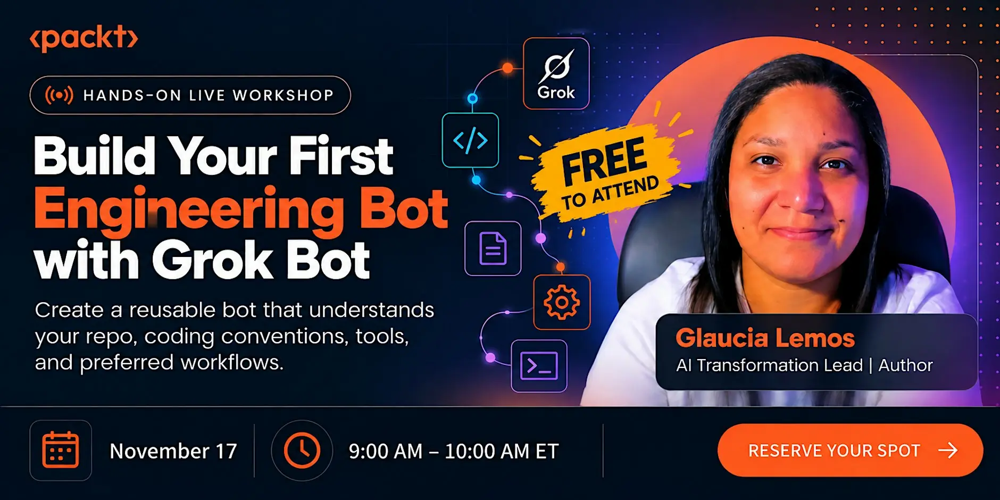
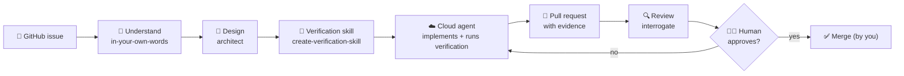
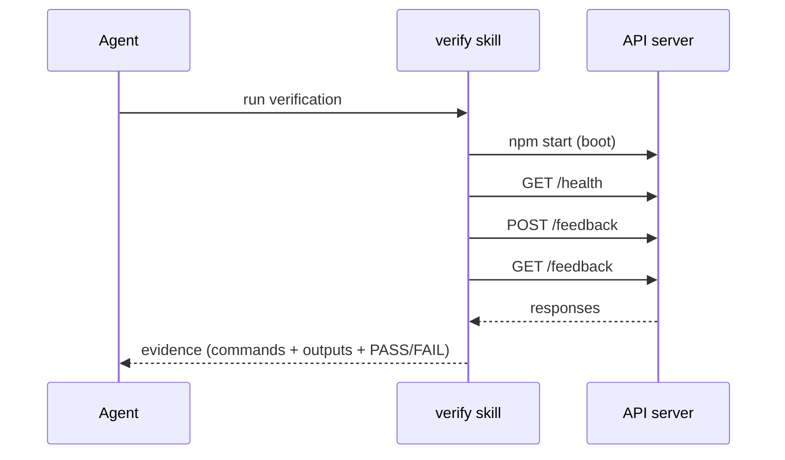
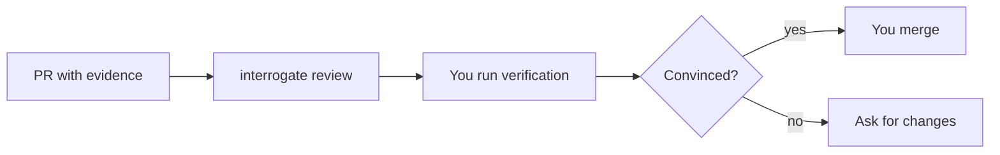

<a id="top"></a>
<div align="center">



# Build Your First Engineering Bot with Grok Bot

**A hands-on Packt workshop · November 17, 2026 · 9–10 AM ET (11h–12h Brasília)**

<p>


</p>

English · [Português (Brasil)](README.pt-br.md)

</div>

> **How to use this README.** Every step has three parts: the **prompt to paste**, the **expected result**, and a **checkpoint branch**. If you fall behind, check out the checkpoint branch and continue from there. Nobody gets left behind.

---

## Contents

- [What you will build](#what)
- [The project: Talk Feedback API](#project)
- [Agenda](#agenda)
- [Before the event (prerequisites)](#prereqs)
- [Step 1 · Setup check (0–5 min)](#step1)
- [Step 2 · Understand and design (5–15 min)](#step2)
- [Step 3 · Build the verification skill (15–30 min)](#step3)
- [Step 4 · Background task: the cloud agent opens a PR (30–42 min)](#step4)
- [Step 5 · Human approval (42–55 min)](#step5)
- [Step 6 · Q&A (55–60 min)](#step6)
- [Extended (90 min) · A daily triage routine](#extended)
- [Checkpoint branches](#checkpoints)
- [Credits and further reading](#credits)
- [About the presenter](#creator)

---

<a id="what"></a>
## What you will build

An **engineering bot** that takes a GitHub issue, understands it, designs a solution, implements it in the background, and opens a pull request **with evidence**. You stay in control: **the bot proposes, the human approves.**



<a id="project"></a>
## The project: Talk Feedback API

A tiny TypeScript API where event attendees submit and list feedback on talks.

| Method | Path | What it does |
| :--- | :--- | :--- |
| `GET` | `/health` | Returns `{ "status": "ok" }` |
| `POST` | `/feedback` | Creates feedback `{ talkId, author, comment }` → `201` |
| `GET` | `/feedback?talkId=...` | Lists feedback, optionally filtered by talk |

```text
src/app.ts        Fastify routes
src/store.ts      In-memory store
src/server.ts     Starts the server (PORT defaults to 3000; HOST defaults to 0.0.0.0)
test/app.test.ts  Vitest tests
docs/issues/      Seed issues for the workshop
.agents/skills/   pstack skills (MIT, Lauren Tan)
```

Run it yourself:

```sh
npm install
npm test
npm start
```

<a id="agenda"></a>
## Agenda

```mermaid
gantt
    title 60-minute base agenda
    dateFormat mm
    axisFormat %M min
    section Hands-on
    Setup check            :a1, 00, 5m
    Understand + design    :a2, after a1, 10m
    Verification skill     :a3, after a2, 15m
    Background task (PR)   :a4, after a3, 12m
    Human approval         :a5, after a4, 13m
    Q&A                    :a6, after a5, 5m
```



| Time | Block | Skill | Checkpoint branch |
| :--- | :--- | :--- | :--- |
| Before | Prerequisites | — | `main` |
| 0–5 | Setup check | — | `checkpoint/01-setup` |
| 5–15 | Understand + design | `in-your-own-words`, `architect` | `checkpoint/02-design` |
| 15–30 | Verification skill | `create-verification-skill` | `checkpoint/03-verification` |
| 30–42 | Background task | cloud agent | `checkpoint/04-backup-pr` |
| 42–55 | Human approval | `interrogate` | `checkpoint/04-backup-pr` |
| 55–60 | Q&A | — | — |
| *Extended (90 min)* | Daily triage routine + more Q&A | Scheduler draft | `checkpoint/05-routine` |

---

<a id="prereqs"></a>
## Before the event (prerequisites)

Do this **before** November 17. It takes about 10 minutes.

1. Create a **Grok Bot** account and sign in.
2. **Connect GitHub** to Grok Bot (Settings → Connections → GitHub).
3. **Fork** this repository to your own GitHub account.
4. Optional, to run things locally: install [Node.js 24 LTS](https://nodejs.org/) and [Git](https://git-scm.com/).

✅ **Expected result:** you have your own fork, and Grok Bot can see it.

---

<a id="step1"></a>
## Step 1 · Setup check (0–5 min)

**Paste this prompt in Grok Bot** (replace `<your-user>`):

```text
Read the repository <your-user>/grok-bot-engineering-workshop.
Tell me in 5 bullet points: what the API does, its endpoints,
how to run the tests, and which skills are in .agents/skills.
Do not change anything.
```

✅ **Expected result:** a short summary that mentions the 3 endpoints, `npm test`, and the 5 skills.

🚩 **Checkpoint branch:** `checkpoint/01-setup`

---

<a id="step2"></a>
## Step 2 · Understand and design (5–15 min)

We start from a **deliberately vague** issue: [`docs/issues/01-add-talk-rating.md`](docs/issues/01-add-talk-rating.md) — *"add talk rating"*. Real issues look like this.

**2.1 · Paste this prompt** (understand):

```text
Use the in-your-own-words skill from .agents/skills/in-your-own-words.
Read docs/issues/01-add-talk-rating.md and restate the request in your own words.
List what is ambiguous and ask me the questions you need answered.
Do not write code.
```

✅ **Expected result:** a restatement plus questions, for example *"Rating scale 1–5? One rating per author? Part of feedback or a separate endpoint?"*

**2.2 · Answer the questions.** Suggested answers:

```text
Rating is an integer from 1 to 5, optional, part of POST /feedback.
Add GET /talks/:talkId/rating that returns { talkId, average, count }.
```

**2.3 · Paste this prompt** (design):

```text
Use the architect skill from .agents/skills/architect.
Design the smallest change for the clarified rating feature.
Show the files you will change, the API contract, and the tests.
Do not write code yet.
```

✅ **Expected result:** a short design: `src/store.ts`, `src/app.ts`, `test/app.test.ts`, the request/response shapes, and the test cases.

🚩 **Checkpoint branch:** `checkpoint/02-design` (contains `docs/design/talk-rating.md`)

---

<a id="step3"></a>
## Step 3 · Build the verification skill (15–30 min)

> **Build the lever.** Instead of checking the bot's work by hand every time, build a tool once that proves the work is correct. This idea comes from Lauren Tan ([@poteto](https://x.com/poteto)) and her [pstack](https://github.com/cursor/plugins/tree/main/pstack) principles.



**Paste this prompt:**

```text
Use the create-verification-skill skill from .agents/skills/create-verification-skill.
Create a verification skill for this API in .agents/skills/verify-talk-feedback.
It must: 1) boot the API with npm start on a free port,
2) call GET /health, POST /feedback and GET /feedback with curl,
3) stop the server, 4) print the evidence: each command, its output, and PASS or FAIL.
Add an npm script "verify" that runs it.
Then run it once and show me the evidence.
```

✅ **Expected result:** a new folder `.agents/skills/verify-talk-feedback/` with a `SKILL.md` and a script, a new `npm run verify` command, and evidence ending with `Result: 4/4 PASS`.

🚩 **Checkpoint branch:** `checkpoint/03-verification`

---

<a id="step4"></a>
## Step 4 · Background task: the cloud agent opens a PR (30–42 min)

Now the bot works **in the background** while you keep going.

**Paste this prompt:**

```text
In the background, using a cloud agent, implement the talk rating feature
following the design from Step 2.
Run npm test and the verify-talk-feedback skill.
Open a pull request to main with: what changed, why, how to test,
and the verification evidence. Do not merge.
```

✅ **Expected result:** within a few minutes, a PR link. The PR description includes test results and verification evidence.

> ⏱️ **A backup PR always exists.** Cloud agents can be slow during a live session. If your PR is not ready, use the branch `checkpoint/04-backup-pr` and continue with Step 5.

🚩 **Checkpoint branch:** `checkpoint/04-backup-pr`

---

<a id="step5"></a>
## Step 5 · Human approval (42–55 min)

The bot can review. **Only a human approves.**

**5.1 · Paste this prompt** (review):

```text
Use the interrogate skill from .agents/skills/interrogate.
Review the pull request <PR link>. Challenge it: what could be wrong,
which cases are not tested, and does the evidence really prove the feature works?
Do not approve and do not merge.
```

✅ **Expected result:** a list of questions and risks (for example *"What happens with rating 0 or 6?"*).

**5.2 · Run the verification yourself.** Do not trust, verify:

```sh
git fetch origin
git checkout <pr-branch>
npm install
npm test
npm run verify      # boots the API, calls every endpoint, prints PASS/FAIL
# optional, by hand:
npm start
# in another terminal:
curl -s -X POST localhost:3000/feedback -H 'content-type: application/json' \
  -d '{"talkId":"keynote","author":"me","comment":"great","rating":5}'
curl -s localhost:3000/talks/keynote/rating
```

✅ **Expected result:** tests are green, `npm run verify` ends with `Result: 9/9 PASS`, and you see `"average":5`.

**5.3 · Decide.** Approve and merge **yourself** on GitHub, or ask for changes. **Never auto-merge.**



---

<a id="step6"></a>
## Step 6 · Q&A (55–60 min)

Questions! Want to keep practicing? Try the other seed issues:
[`02-delete-feedback.md`](docs/issues/02-delete-feedback.md) and [`03-feedback-summary.md`](docs/issues/03-feedback-summary.md).

---

<a id="extended"></a>
## Extended (90 min) · A daily triage routine

> 🕐 **Only in the 90-minute version.** In the 60-minute version, this is homework.

**Extended block A · Draft a scheduled triage routine (about 20 min)**

**Paste this prompt:**

```text
Read docs/routines/daily-triage.md and draft the scheduler configuration
for this repository: weekdays at 9 AM in America/Sao_Paulo.
Use the execution prompt and private delivery rules from that document.
Propose labels (bug, feature, unclear); do not apply them.
Show the definition and a sample summary for review. Keep it disabled;
do not create or enable a scheduled task during this exercise.
```

✅ **Expected result:** a disabled scheduler draft and a sample summary, using [`docs/routines/daily-triage.md`](docs/routines/daily-triage.md). After review, configure it in an agent scheduler that supports GitHub access, an IANA timezone, persistent run state, and private delivery. If your environment lacks a scheduler, keep the draft and run the prompt manually; a Markdown file alone does not schedule execution.

🚩 **Checkpoint branch:** `checkpoint/05-routine`

**Extended block B · More Q&A (about 10 min)**

---

<a id="checkpoints"></a>
## Checkpoint branches

```sh
git fetch origin
git checkout checkpoint/02-design   # replace with the branch you need
```

| Branch | State |
| :--- | :--- |
| `checkpoint/01-setup` | Starting point: API, tests, skills, seed issues |
| `checkpoint/02-design` | + design doc `docs/design/talk-rating.md` |
| `checkpoint/03-verification` | + `verify-talk-feedback` skill and `npm run verify` |
| `checkpoint/04-backup-pr` | + talk rating implemented with tests (backup PR) |
| `checkpoint/05-routine` | + daily triage routine `docs/routines/daily-triage.md` (extended) |

---

<a id="credits"></a>
## Credits and further reading

- **pstack** by Lauren Tan ([@poteto](https://x.com/poteto)): the skills in [`.agents/skills`](.agents/skills) are copied from [cursor/plugins/pstack](https://github.com/cursor/plugins/tree/1e5c90a4b6f249917bd21fe361b3a2a7deb741b8/pstack) under the MIT license. See [NOTICE](.agents/skills/NOTICE.md) and [LICENSE](.agents/skills/LICENSE). The *build the lever* idea is hers.
- **Further reading:** Matt Pocock's [mattpocock/skills](https://github.com/mattpocock/skills) (MIT), another collection of agent skills. It is not used in this workshop.

## License

Original workshop code and text: [MIT](LICENSE), © 2026 Glaucia Lemos. Third-party skills keep their own license (see above).

---

<a id="creator"></a>
## About the presenter

<div align="center">
<a href="https://github.com/glaucia86"></a>

<h3>Glaucia Lemos</h3>
<p><strong>AI Transformation Lead · Author</strong></p>
<p>I work with AI and software engineering, building applications and exploring<br>AI coding agents with JavaScript and TypeScript. I share practical knowledge<br>through open-source projects, talks, and technical content.</p>

<p>
<a href="https://www.youtube.com/user/l32759"></a>
<a href="https://www.linkedin.com/in/glaucialemos/"></a>
<a href="https://x.com/glaucia_lemos86"></a>
</p>
<p>
<a href="https://github.com/glaucia86"></a>
<a href="https://www.twitch.tv/glaucia_lemos86"></a>
<a href="https://dev.to/glaucia86"></a>
</p>
<p><a href="https://linktr.ee/glaucia_lemos86">Linktree</a> · <a href="#top">↑ Back to top</a></p>
<p><strong>The bot proposes. The human approves.</strong></p>
</div>
