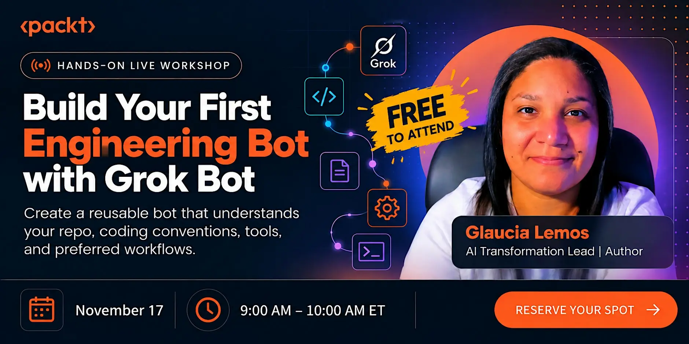
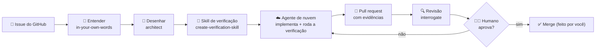
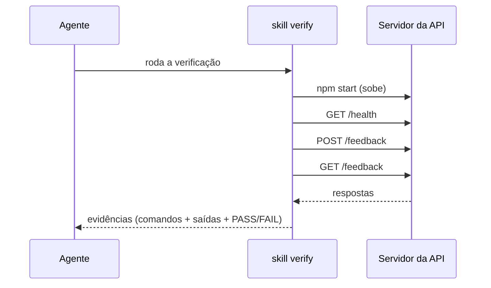
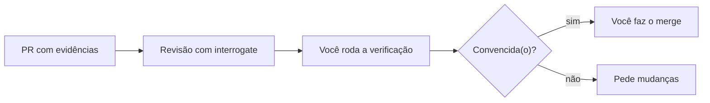

<a id="top"></a>
<div align="center">



# Crie seu primeiro bot de engenharia com o Grok Bot

**Um workshop prático da Packt · 17 de novembro de 2026 · 9h–10h30 ET (11h–12h30 Brasília) · 90 minutos**

<p>


</p>

[English](README.md) · Português (Brasil)

</div>

> **Como usar este README.** Cada passo tem três partes: o **prompt para colar**, o **resultado esperado** e uma **branch de checkpoint**. Se você ficar para trás, é só fazer checkout da branch de checkpoint e continuar dali. Ninguém fica para trás.
>
> Os prompts estão em inglês de propósito: são exatamente os mesmos que usaremos ao vivo. Cole como estão.

---

## Sumário

- [O que você vai construir](#what)
- [O projeto: Talk Feedback API](#project)
- [Agenda](#agenda)
- [Antes do evento (pré-requisitos)](#prereqs)
- [Passo 1 · Conferindo o setup (0–5 min)](#step1)
- [Passo 2 · Entender e desenhar (5–20 min)](#step2)
- [Passo 3 · Criando a skill de verificação (20–40 min)](#step3)
- [Passo 4 · Tarefa em segundo plano: o agente de nuvem abre um PR (40–55 min)](#step4)
- [Passo 5 · Aprovação humana (55–70 min)](#step5)
- [Passo 6 · Uma rotina diária de triagem (70–82 min)](#step6)
- [Passo 7 · Perguntas e respostas (82–90 min)](#step7)
- [Branches de checkpoint](#checkpoints)
- [Créditos e leituras complementares](#credits)
- [Sobre a apresentadora](#creator)

---

<a id="what"></a>
## O que você vai construir

Um **bot de engenharia** que pega uma issue do GitHub, entende o pedido, desenha uma solução, implementa em segundo plano e abre um pull request **com evidências**. Você continua no controle: **o bot propõe, o humano aprova.**



<a id="project"></a>
## O projeto: Talk Feedback API

Uma API pequena em TypeScript onde quem participa de um evento envia e lista feedbacks sobre as palestras.

| Método | Caminho | O que faz |
| :--- | :--- | :--- |
| `GET` | `/health` | Retorna `{ "status": "ok" }` |
| `POST` | `/feedback` | Cria um feedback `{ talkId, author, comment }` → `201` |
| `GET` | `/feedback?talkId=...` | Lista os feedbacks, com filtro opcional por palestra |

```text
src/app.ts        Fastify routes
src/store.ts      In-memory store
src/server.ts     Starts the server (PORT defaults to 3000; HOST defaults to 0.0.0.0)
test/app.test.ts  Vitest tests
docs/issues/      Seed issues for the workshop
.agents/skills/   pstack skills (MIT, Lauren Tan)
```

Para rodar na sua máquina:

```sh
npm install
npm test
npm start
```

<a id="agenda"></a>
## Agenda

```mermaid
gantt
    title Agenda de 90 minutos
    dateFormat mm
    axisFormat %M min
    section Mão na massa
    Conferir setup             :a1, 00, 5m
    Entender + desenhar        :a2, after a1, 15m
    Skill de verificação       :a3, after a2, 20m
    Tarefa em segundo plano    :a4, after a3, 15m
    Aprovação humana           :a5, after a4, 15m
    Rotina diária de triagem   :a6, after a5, 12m
    Perguntas                  :a7, after a6, 8m
```



| Tempo | Bloco | Skill | Branch de checkpoint |
| :--- | :--- | :--- | :--- |
| Antes | Pré-requisitos | — | `main` |
| 0–5 | Conferir setup | — | `checkpoint/01-setup` |
| 5–20 | Entender + desenhar | `in-your-own-words`, `architect` | `checkpoint/02-design` |
| 20–40 | Skill de verificação | `create-verification-skill` | `checkpoint/03-verification` |
| 40–55 | Tarefa em segundo plano | agente de nuvem | `checkpoint/04-backup-pr` |
| 55–70 | Aprovação humana | `interrogate` | `checkpoint/04-backup-pr` |
| 70–82 | Rotina diária de triagem | Definição de agendamento | `checkpoint/05-routine` |
| 82–90 | Perguntas e respostas | — | — |

---

<a id="prereqs"></a>
## Antes do evento (pré-requisitos)

Faça isto **antes** de 17 de novembro. Leva uns 10 minutos.

1. Crie uma conta no **Grok Bot** e faça login.
2. **Conecte o GitHub** ao Grok Bot: no chat, peça ao Grok Bot para conectar a sua conta do GitHub. Ele mostra um cartão de conexão no próprio chat; é só seguir.
3. Faça um **fork** deste repositório para a sua conta do GitHub. Na página do fork, **desmarque "Copy the main branch only"** para que as branches de checkpoint venham junto.
4. Opcional, para rodar localmente: instale o [Node.js 24 LTS](https://nodejs.org/) e o [Git](https://git-scm.com/).

✅ **Resultado esperado:** você tem o seu próprio fork, e o Grok Bot consegue enxergá-lo.

---

<a id="step1"></a>
## Passo 1 · Conferindo o setup (0–5 min)

**Cole este prompt no Grok Bot** (troque `<your-user>` pelo seu usuário):

```text
Read the repository <your-user>/grok-bot-engineering-workshop.
Tell me in 5 bullet points: what the API does, its endpoints,
how to run the tests, and which skills are in .agents/skills.
Do not change anything.
```

✅ **Resultado esperado:** um resumo curto que cita os 3 endpoints, o `npm test` e as 5 skills.

🚩 **Branch de checkpoint:** `checkpoint/01-setup`

---

<a id="step2"></a>
## Passo 2 · Entender e desenhar (5–20 min)

Começamos com uma issue **propositalmente vaga**: [`docs/issues/01-add-talk-rating.md`](docs/issues/01-add-talk-rating.md) — *"add talk rating"*. Issues reais são assim mesmo.

**2.1 · Cole este prompt** (entender):

```text
Use the in-your-own-words skill from .agents/skills/in-your-own-words.
Read docs/issues/01-add-talk-rating.md and restate the request in your own words.
List what is ambiguous and ask me the questions you need answered.
Do not write code.
```

✅ **Resultado esperado:** o pedido reescrito com as palavras do bot, mais perguntas, por exemplo *"A nota vai de 1 a 5? Uma nota por autor? Faz parte do feedback ou é um endpoint separado?"*

**2.2 · Responda às perguntas.** Respostas sugeridas:

```text
Rating is an integer from 1 to 5, optional, part of POST /feedback.
Add GET /talks/:talkId/rating that returns { talkId, average, count }.
```

**2.3 · Cole este prompt** (desenhar):

```text
Use the architect skill from .agents/skills/architect.
Design the smallest change for the clarified rating feature.
Show the files you will change, the API contract, and the tests.
Do not write code yet.
Save the design to docs/design/talk-rating.md and commit it to my fork,
so a cloud agent can read it later.
```

✅ **Resultado esperado:** um desenho curto: `src/store.ts`, `src/app.ts`, `test/app.test.ts`, o formato de request/response e os casos de teste, salvo e commitado como `docs/design/talk-rating.md` no seu fork.

🚩 **Branch de checkpoint:** `checkpoint/02-design` (contém `docs/design/talk-rating.md`)

---

<a id="step3"></a>
## Passo 3 · Criando a skill de verificação (20–40 min)

> **Construa a alavanca.** Em vez de conferir o trabalho do bot na mão toda vez, construa uma ferramenta, uma única vez, que prove que o trabalho está correto. Essa ideia é da Lauren Tan ([@poteto](https://x.com/poteto)) e dos princípios do [pstack](https://github.com/cursor/plugins/tree/main/pstack).



**Cole este prompt:**

```text
Use the create-verification-skill skill from .agents/skills/create-verification-skill.
Create a verification skill for this API in .agents/skills/verify-talk-feedback.
It must: 1) boot the API with npm start on a free port,
2) call GET /health, POST /feedback and GET /feedback with curl,
3) stop the server, 4) print the evidence: each command, its output, and PASS or FAIL.
Add an npm script "verify" that runs it.
Then run it once and show me the evidence.
Finally, commit the new verification skill and the verify script to my fork.
```

✅ **Resultado esperado:** uma pasta nova `.agents/skills/verify-talk-feedback/` com um `SKILL.md` e um script, um comando novo `npm run verify`, evidências terminando em `Result: 4/4 PASS`, e um commit no seu fork.

🚩 **Branch de checkpoint:** `checkpoint/03-verification`

---

<a id="step4"></a>
## Passo 4 · Tarefa em segundo plano: o agente de nuvem abre um PR (40–55 min)

Agora o bot trabalha **em segundo plano** enquanto você segue em frente.

**Cole este prompt:**

```text
In the background, using a cloud agent, implement the talk rating feature
following the design in docs/design/talk-rating.md.
Extend the verification skill in .agents/skills/verify-talk-feedback before running it.
Keep the four existing checks and add these five checks on a fresh server:
1) POST /feedback with rating 4 returns 201 and echoes rating 4;
2) POST /feedback for the same talk with rating 5 returns 201 and echoes rating 5;
3) POST /feedback with rating 6 returns 400;
4) GET /talks/:talkId/rating for that talk returns average 4.5 and count 2;
5) GET /talks/:talkId/rating for a talk without ratings returns average null and count 0.
Use isolated talk IDs so the existing checks do not affect these assertions.
Commit the updated checks with the feature in the same PR.
Run npm test and npm run verify. Require Result: 9/9 PASS from the executed checks;
if a check fails, fix the implementation or report the failure without fabricating evidence.
Open a pull request to main with: what changed, why, how to test,
and the verification evidence. Do not merge.
```

✅ **Resultado esperado:** em poucos minutos, um link de PR. A descrição do PR traz os resultados dos testes e as evidências da verificação.

> ⏱️ **Sempre existe um PR de reserva.** Agentes de nuvem podem demorar durante uma sessão ao vivo. Se o seu PR não ficar pronto, use a branch `checkpoint/04-backup-pr` e continue no Passo 5.

🚩 **Branch de checkpoint:** `checkpoint/04-backup-pr`

---

<a id="step5"></a>
## Passo 5 · Aprovação humana (55–70 min)

O bot pode revisar. **Só um humano aprova.**

**5.1 · Cole este prompt** (revisão):

```text
Use the interrogate skill from .agents/skills/interrogate.
Review the pull request <PR link>. Challenge it: what could be wrong,
which cases are not tested, and does the evidence really prove the feature works?
Do not approve and do not merge.
```

✅ **Resultado esperado:** uma lista de perguntas e riscos (por exemplo *"O que acontece com nota 0 ou 6?"*).

**5.2 · Rode a verificação você mesma(o).** Não confie, verifique:

```sh
git fetch origin
git checkout <pr-branch>
npm install
npm test
npm run verify      # boots the API, calls every endpoint, prints PASS/FAIL
# optional, by hand:
npm start
# in another terminal:
curl -s -X POST localhost:3000/feedback -H 'content-type: application/json' \
  -d '{"talkId":"keynote","author":"me","comment":"great","rating":5}'
curl -s localhost:3000/talks/keynote/rating
```

**Sem Node.js ou clone local?** Peça ao Grok Bot para fazer isso por você e mostrar as evidências:

```text
Check out the branch of pull request <PR link>, run npm install, npm test
and npm run verify, and show me each command with its full output.
Do not approve and do not merge.
```

✅ **Resultado esperado:** testes verdes, `npm run verify` terminando em `Result: 9/9 PASS`, e os checks de notas mostram `"average":4.5` com `"count":2`. O exemplo manual opcional, em um servidor novo, retorna `"average":5`.

**5.3 · Decida.** Aprove e faça o merge **você mesma(o)** no GitHub, ou peça mudanças. **Nunca use auto-merge.**



---

<a id="step6"></a>
## Passo 6 · Uma rotina diária de triagem (70–82 min)

Prepare uma definição de triagem agendada para revisão e ativação posterior.

**Cole este prompt:**

```text
Read docs/routines/daily-triage.md and draft the scheduler configuration
for this repository: weekdays at 9 AM in America/Sao_Paulo.
Use the execution prompt and private delivery rules from that document.
Propose labels (bug, feature, unclear); do not apply them.
Show the definition and a sample summary for review. Keep it disabled;
do not create or enable a scheduled task during this exercise.
```

✅ **Resultado esperado:** uma definição de agendamento desativada e uma prévia, seguindo [`docs/routines/daily-triage.md`](docs/routines/daily-triage.md). O documento descreve os requisitos do agendador e uma alternativa manual; nenhuma rotina é ativada neste exercício.

🚩 **Branch de checkpoint:** `checkpoint/05-routine`

---

<a id="step7"></a>
## Passo 7 · Perguntas e respostas (82–90 min)

Hora das perguntas! Quer continuar praticando? Experimente as outras issues de exemplo:
[`02-delete-feedback.md`](docs/issues/02-delete-feedback.md) e [`03-feedback-summary.md`](docs/issues/03-feedback-summary.md).

---

<a id="checkpoints"></a>
## Branches de checkpoint

```sh
git fetch origin
git checkout checkpoint/02-design   # replace with the branch you need
```

| Branch | Estado |
| :--- | :--- |
| `checkpoint/01-setup` | Ponto de partida: API, testes, skills, issues de exemplo |
| `checkpoint/02-design` | + documento de design `docs/design/talk-rating.md` |
| `checkpoint/03-verification` | + skill `verify-talk-feedback` e `npm run verify` |
| `checkpoint/04-backup-pr` | + avaliação de palestras implementada com testes (PR de reserva) |
| `checkpoint/05-routine` | + rotina diária de triagem `docs/routines/daily-triage.md` |

---

<a id="credits"></a>
## Créditos e leituras complementares

- **pstack**, da Lauren Tan ([@poteto](https://x.com/poteto)): as skills em [`.agents/skills`](.agents/skills) foram copiadas de [cursor/plugins/pstack](https://github.com/cursor/plugins/tree/1e5c90a4b6f249917bd21fe361b3a2a7deb741b8/pstack) sob a licença MIT. Veja o [NOTICE](.agents/skills/NOTICE.md) e a [LICENSE](.agents/skills/LICENSE). A ideia de *construir a alavanca* é dela.
- **Leitura complementar:** o [mattpocock/skills](https://github.com/mattpocock/skills) (MIT), do Matt Pocock, outra coleção de skills para agentes. Ele não é usado neste workshop.

## Licença

Código e texto originais do workshop: [MIT](LICENSE), © 2026 Glaucia Lemos. As skills de terceiros mantêm a própria licença (veja acima).

---

<a id="creator"></a>
## Sobre a apresentadora

<div align="center">
<a href="https://github.com/glaucia86"></a>

<h3>Glaucia Lemos</h3>
<p><strong>AI Transformation Lead · Autora</strong></p>
<p>Trabalho com IA e engenharia de software, criando aplicações e explorando<br>agentes de código com IA usando JavaScript e TypeScript. Compartilho conhecimento prático<br>por meio de projetos open source, palestras e conteúdo técnico.</p>

<p>
<a href="https://www.youtube.com/user/l32759"></a>
<a href="https://www.linkedin.com/in/glaucialemos/"></a>
<a href="https://x.com/glaucia_lemos86"></a>
</p>
<p>
<a href="https://github.com/glaucia86"></a>
<a href="https://www.twitch.tv/glaucia_lemos86"></a>
<a href="https://dev.to/glaucia86"></a>
</p>
<p><a href="https://linktr.ee/glaucia_lemos86">Linktree</a> · <a href="#top">↑ Voltar ao topo</a></p>
<p><strong>O bot propõe. O humano aprova.</strong></p>
</div>
