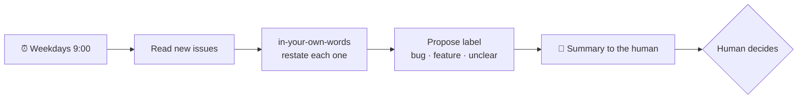

# Daily triage routine (Extended, 90 min)

Built with the `automate-me` skill (`.agents/skills/automate-me`).

## Goal

Every weekday at 9:00 AM (Brasília), the bot reads the issues opened since the last run,
restates each one in its own words, proposes a label, and sends a short summary.
**It never changes code, closes issues, or merges anything.**



## Prompt to paste

```text
Use the automate-me skill from .agents/skills/automate-me.
Create a daily routine for this repository: every weekday at 9 AM Brasília time,
read issues opened since the last run, restate each one in your own words,
propose one label (bug, feature, unclear), and send me a short triage summary.
Do not change code, do not close issues, do not apply labels without my approval.
Show me the routine before turning it on.
```

## Routine instructions (what the bot runs each day)

1. List open issues created since the previous run. If none, send "No new issues" and stop.
2. For each issue:
   - restate it in 1–2 sentences (in-your-own-words);
   - propose one label: `bug`, `feature`, or `unclear`;
   - if `unclear`, write the 1–3 questions the author must answer.
3. Send one summary in this format:

```text
Daily triage · <date>
1. #<n> <title> → <label>
   In my words: <restatement>
   Questions: <only if unclear>
Next step: reply "apply labels" to let me label them.
```

## Guardrails

| Allowed | Not allowed |
| :--- | :--- |
| Read issues | Edit code, open PRs |
| Draft labels and questions | Close, delete, or label issues without approval |
| Send the summary to you | Post comments publicly |

## Expected first run (with the seed issues)

```text
Daily triage · Nov 17
1. add talk rating → unclear
   In my words: attendees want to score talks.
   Questions: what scale? required or optional? where is the average shown?
2. Allow deleting a feedback entry → feature
3. Feedback summary per talk → feature
```
